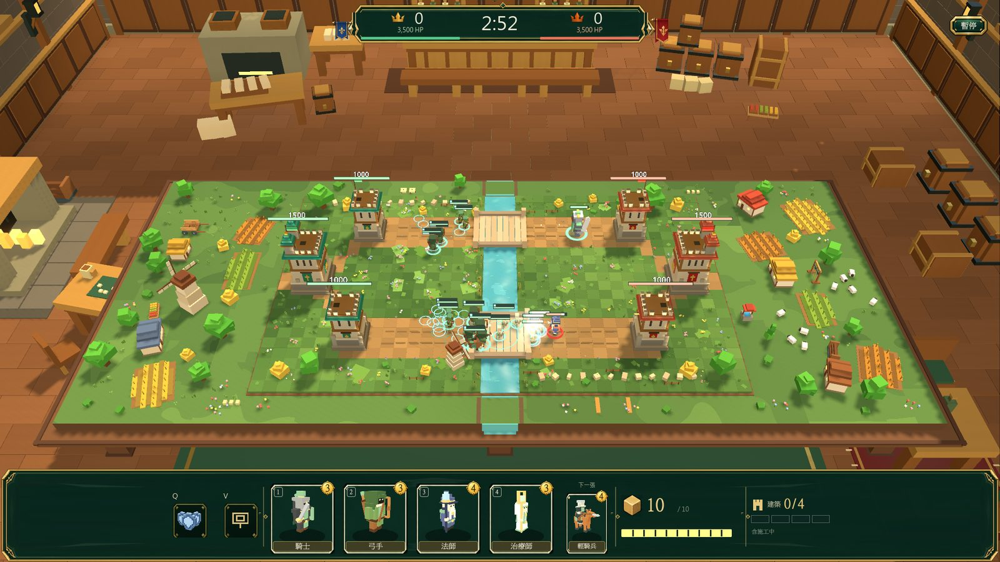

# Tabletop Kingdoms 遊戲介紹頁

我開發中的 Godot 遊戲《Tabletop Kingdoms》的介紹頁，版面參考 Steam 商店頁，用 Vibe Coding 做成。

- 網站：https://s11430624-wq.github.io/tabletop-kingdoms-cards/
- 規格書：[SPEC.md](SPEC.md)
- 程式：[index.html](index.html)（CSS、JavaScript、卡牌資料全部內嵌）；截圖在 [images/](images/)，全部是遊戲實機畫面

功能：截圖輪播（縮圖、箭頭、鍵盤、手機滑動、自動播放）與全螢幕燈箱、願望清單／追蹤／分享、點標籤跳到對應特色、章節巡禮分頁、可篩選與翻面的卡牌一覽、更新紀錄與常見問題手風琴、數字動畫、手機版選單。
